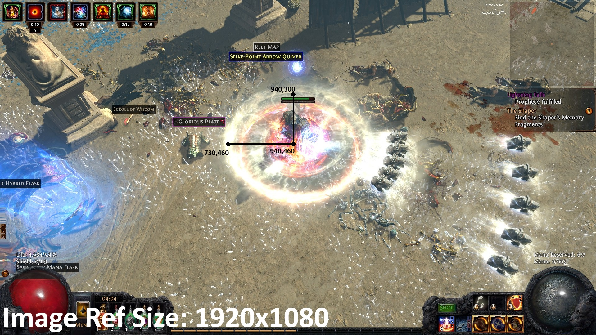

# Skyrim ARPG Style Camera Mod

A Path of Exile style camera for Skyrim. It locks the camera at a fixed top-down angle, and indoors it cuts away the walls and roofs between the camera and you, so you always see your character.

It's built to be played with **WASD and a lock-on key** (True Directional Movement's target lock). Move freely with WASD. Press your lock-on key to snap rotate your camera in the direction your character is facing, or onto a target., or onto the nearest enemy, to aim attacks and spells. Tested on Skyrim **1.7.104**.

## Suggested modpack
- **Base:** [SKSE](https://skse.silverlock.org/), [Address Library](https://www.nexusmods.com/skyrimspecialedition/mods/32444), [SkyUI](https://www.nexusmods.com/skyrimspecialedition/mods/12604), [MCM Helper](https://www.nexusmods.com/skyrimspecialedition/mods/53000), Pandora Behaviour Engine
- **Camera:** this mod, [3PCO](https://www.nexusmods.com/skyrimspecialedition/mods/18515), [True Directional Movement](https://www.nexusmods.com/skyrimspecialedition/mods/51614), [Some Collision Camera](https://www.nexusmods.com/skyrimspecialedition/mods/57864), [Motion Sensitive Fix](https://www.nexusmods.com/skyrimspecialedition/mods/35833)
- **Combat:** [Precision](https://www.nexusmods.com/skyrimspecialedition/mods/72347)
- **Skills and spells:** Ordinator, Apocalypse, [Summermyst](https://www.nexusmods.com/skyrimspecialedition/mods/6285)
- **Loot:** [Grid Inventory - DiabloRim](https://www.nexusmods.com/skyrimspecialedition/mods/190634), [Socketing](https://www.nexusmods.com/skyrimspecialedition/mods/195740)
- **Optional:** [SKSE Menu Framework](https://www.nexusmods.com/skyrimspecialedition/mods/120352), for the in-game settings menu

Run Pandora, then launch with `skse64_loader.exe`.

## Camera mod settings required
**3PCO:** FOV 90, camera speed 0, min/max zoom 600. Every offset and zoom 0 in Sheathed, Melee, Ranged and Sneak. Auto 3rd/1st person, crosshair, Ranged Cam and Magic is Ranged all off. The four Sneak toggles off.

**True Directional Movement:** directional movement on, Auto Adjust Camera off, target lock pitch/yaw adjust speed at minimum. Reset Camera with Target Lock on, Reset Camera Pitch off. Lock on before using magic or bows.

## Camera locker
Locks the camera's pitch (and optionally yaw) every frame. Indoors, it keeps your room drawn when the camera sits above the ceiling.
- **F10:** on/off
- **Page Up / Page Down:** more top-down / flatter
- Pitch 30 = Path of Exile 2 / Diablo II, 50 = Path of Exile

<b>Angle math</b>

| Game | Pitch |
|---|---|
| Diablo II | 30 (2:1 floor tiles: arcsin(1 ÷ 2) = 30°) |
| Path of Exile | 50 (ring 210 × 160 px at 1080p: arcsin(160 ÷ 210) = 49.6°) |
| Path of Exile 2 | 30 (ring ~700 × 350 px: arcsin(350 ÷ 700) = 30°) |
| Diablo IV | not measured yet |

**Pitch = arcsin(height ÷ width)**

To measure any game, screenshot a circle on the ground (an AoE ring) near the center of the screen, then measure its width and height in pixels. ARPGs use a narrow lens from far away, so also lower 3PCO's FOV (~40–55) and raise the zoom.

## Camera splitter
Indoors, everything above a cut line is removed by the GPU. Walls end cleanly and roofs vanish, while floors, furniture and characters stay. The background goes black.
- **F9:** *Auto* (split only when walls block the view) or *Always* (Diablo look)
- The cut stays at one height per floor. Jumps don't move it, and changes ease in.
- The cut rises behind you, so far walls stay full height.
- Idea from machinegod's *Skyrim Camera Disocclusion System*. This is a separate implementation.

## Settings
**In game:** with SKSE Menu Framework, open its menu (F1) and go to **Skyrim ARPG Style Camera**. Changes apply live. Click **Save to INI** to keep them.

**INI:** `Data/SKSE/Plugins/SkyrimARPGCamera.ini`. **F8** reloads it in game. Key codes are DirectX scan codes (0x44 = F10).

<b>[Camera]</b> camera locker

| Setting | Default | |
|---|---|---|
| `Enabled` | 1 | Lock on at game start |
| `LockPitch` / `Pitch` | 1 / 30 | Lock the angle, degrees looking down |
| `LockYaw` / `Yaw` | 0 / 45 | Lock the compass direction (0 = north) |
| `FixInteriorRooms` | 1 | Draw your room when the camera is above the ceiling |
| `PauseOnTargetLock` | 0 | Let TDM hold the camera while locked on |
| `PitchMode` / `InvertPitch` | 0 / 0 | Leave at 0 unless the camera looks up |
| `ToggleKey` | 0x44 (F10) | Camera on/off |
| `PitchUpKey` / `PitchDownKey` / `PitchStep` | PgUp / PgDn / 5 | Change pitch in game |
| `ReloadKey` | 0x42 (F8) | Reload the INI |
| `DebugLog` | 0 | Log camera values once a second |

<b>[Player]</b> and <b>[GameSettings]</b>

| Setting | Default | |
|---|---|---|
| `CarryWeight` | 10000 | Applied on every load (0 = leave alone) |
| `SpeedMult` | 130 | Movement speed, 100 = vanilla (0 = leave alone) |
| `[GameSettings]` | `fMoveEncumEffect = 0`, `fMoveEncumEffectNoWeapon = 0` | Any engine setting (the names `setgs` uses), applied every launch |

<b>[General]</b> and <b>[Cut]</b> camera splitter

| Setting | Default | |
|---|---|---|
| `Enabled` | 1 | Splitter on/off |
| `InteriorOnly` | 1 | Only split indoors |
| `Height` | 220 | Cut height above the floor (a human is ~128) |
| `Slope` | 1 | How fast the cut rises behind you, so far walls stay (0 = flat) |
| `AutoLift` | 1 | Starting style: 1 = Auto, 0 = Always |
| `StyleKey` | 0x43 (F9) | Switch style |
| `ClearDelay` / `LiftMax` | 0.75 / 600 | Auto: seconds of clear view before it lifts, how far it lifts |
| `ReanchorDistance` / `ReanchorDelay` | 150 / 1 | How far and how long you must stand on a new floor before the cut moves |
| `HeightSmoothing` / `MaxHeightSpeed` | 0.6 / 800 | How gently height changes ease in |
| `AllGeometry` | 1 | Leave on (keeps props and characters visible) |

<b>[Cells]</b>, <b>[Background]</b>, <b>[Debug]</b>

| Setting | Default | |
|---|---|---|
| `[Cells] EditorID = 260` or `= off` | none | Per-interior cut height or off. Editor IDs show in the log. |
| `BlackFog` | 1 | Black interior fog while inside |
| `HideSky` | 1 | Hide the sky dome while inside |
| `Log` | 0 | Write `[cut]` diagnostics to `SkyrimARPGCamera.log` |

